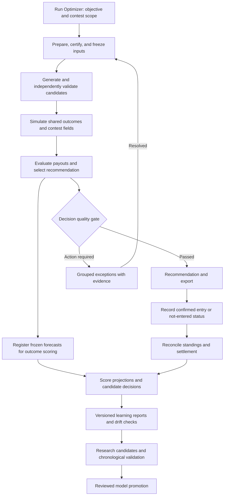

# Automated decision, quality control, and learning

Status: proposed architecture, 2026-10-10. No runtime changes, scheduled jobs, model promotions, contest entries, or default changes are implemented by this document. Implementation priority is tracked in [the canonical backlog](../TODO.md).

Implemented separately: [one provisional GPP candidate recommendation](gpp_candidate_recommendation.md) now freezes a projection-first comparison and supports one-lineup export. Calibrated paid-finish, expected-return, automatic settlement and model-promotion portions of this architecture remain unimplemented.

## Product decision

Make **Run Optimizer** the entry to one durable decision workflow:

**Prepare and validate → generate candidates → evaluate contest outcomes → recommend → review meaningful exceptions → record entry → settle and learn.**

The immediate recommendation is **one lineup per slate, reused across that slate's GPP contests**, per the user's 2026-10-10 preference. Generate and compare multiple candidates internally, then recommend one; saved contest selection is not a prerequisite for slate-level generation or recommendation. Contest-specific expected return requires field and payout evidence, which can be attached later; without it, mark financial estimates unavailable rather than inventing a generic ROI. Lineup–contest pairing, allocation and portfolio recommendations are deferred. “Best” means best among the candidates evaluated under a recorded objective, constraints, and evidence; it is not a guarantee or proof of global optimality. “No supported recommendation” is a valid result. This requirement does not itself change existing runtime lineup-count settings.

Use **consistent paid finishes in GPP tournaments** as the primary objective for this design. “In the money” means a paid GPP finish; cash games are outside this delivery scope. Keep entry cash frequency, entry profit frequency, and net-positive slate frequency distinct. Selecting a lineup likely to receive any payout can still produce a losing slate when fees across multiple entries exceed winnings. Budget, maximum slate loss, entry count, and acceptable contest families must be explicit saved preferences before recommending stake allocations; no budget is inferred here.

Keep GPP play and existing tournament defaults. The future UI should state “GPP paid-finish consistency” and expose the tradeoff with expected return and top-end finishes. Any revised tournament selection policy requires validation before rollout; the goal does not call for a switch to cash games.

Implementation update: the [shared Classic/Captain audit](shared_classic_captain_path_audit.md) records repaired Showdown simulation, scope checks, additional saved slate labels and fixture validation. Sunday Main is the next live slate. Live source clearance and calibrated GPP outcome estimates remain separate from the implemented repairs.

## Immediate priority and supported slate scope

All near-term work must directly support **paid finishes in GPPs, with expected return and tournament upside evaluated alongside them**. Reliability, projections, ownership, correlation, candidate generation, contest evaluation and outcome measurement belong in this scope when they affect that decision. Broad workflow redesign, report polish and automatic retraining should not delay validating the actual GPP decisions. Cash-game work is deferred. This priority supersedes the earlier implementation sequence below.

Classic and Captain/Showdown are equally important product paths:

| Format | Required initial slates | Acceptance scope |
| --- | --- | --- |
| Classic GPP | Sunday Main | Retain a regression baseline through every improvement |
| Classic GPP | Sunday early-only; Sunday late-only | Independently prepare, project, optimize, validate and export against each exact native salary pool/game set |
| Captain / Showdown GPP | Thursday night; Sunday night; Monday night | Full independent pipeline, Captain/FLEX salary and score treatment, viable Captain coverage, role/availability checks, ownership and duplicate-aware tournament evaluation |
| Additional offered NFL slates | Other Classic or Captain slates when available, including multiple single-game slates on one day | Discover from verified contest/draft-group and salary evidence; validate supported rules; do not infer availability or format from the weekday |

**Initial source findings (not certification):** `ui/src/workspaceContext.ts` lists `SUNDAY_MAIN`, `SUNDAY_EARLY`, `SUNDAY_LATE`, `THURSDAY_NIGHT`, `SUNDAY_NIGHT`, `MONDAY_NIGHT` and several other labels. Its persisted context key uses season/week/label, and restoration checks a fixed label list. `backend/app/weekly_schemas.py` accepts a nonempty slate string and a separate Classic/Showdown format. These provide entry points, not proof of end-to-end support. Other scope keys and consumers still need audit before declaring a collision or a complete fix.

The target scope includes provider, native draft-group/slate identity, exact game IDs, format/rule version and time window; retain season/week and friendly labels for navigation. A contest ID identifies its payout/entry rules and links to that native slate. Separate same-night games, early/late subsets and different rule variants must never overwrite or reuse incompatible projections, salaries, caches, active selections, candidate pools or export IDs. Provide a verified salary-manifest/game-set identity when native identifiers are unavailable, with entry compatibility still an explicit gate.

Projection builds must work from the selected slate's eligible canonical player pool and current prelock evidence. Compatible base football forecasts can be reused when cutoff/model/input provenance agrees, but salaries, roster eligibility, uncertainty scenarios, ownership and opponent fields remain scoped to the exact contest/slate. Never manufacture early/late projections by simply filtering saved Sunday Main lineup recommendations. A small player pool changes construction and opponent behavior; a model validated on Sunday Main alone does not certify early-only, late-only or Showdown performance.

Captain is a first-class GPP strategy: use one physical-player outcome across CPT/FLEX, apply the native salary and scoring multipliers exactly once, prohibit duplicate physical players, and evaluate viable Captain alternatives with coherent teammate/opponent constructions. Preserve model assessment when user Captain preferences restrict selection. Track Captain selection quality, duplication-adjusted prizes and paid-finish calibration separately from Classic metrics.

### Next execution sequence

1. **Audit and certify the six initial slate paths:** Sunday Main, early, late; Thursday, Sunday and Monday Captain. Trace select/import → prepare → projections → ownership → candidates → validation → contest evaluation → export, using representative frozen fixtures and source-backed live evidence where available. Mark each stage supported, blocked or unverified; a dropdown option is not a pass.
2. **Repair decision-critical gaps:** scope isolation, stale/missing player evidence, projection failures, invalid candidates and Captain handling. Keep changes bounded and preserve Sunday Main behavior with targeted regression checks.
3. **Measure and improve GPP selections:** establish frozen current-policy baselines by slate family; evaluate paid finishes, full payout/ROI and upside against verified historical GPP fields. Diagnose projection error, candidate coverage, selection and contest choice separately. Validate field/outcome estimates before displaying probability claims.
4. **Promote supported improvements and extend slate coverage:** use chronological comparisons and shadow decisions, retain replay/rollback, and add other offered slates through verified native identity rather than new weekday assumptions. Small samples remain explicitly provisional.

Acceptance requires at least one reproducible full-path fixture for each initial family plus negative tests for cross-slate reuse, two same-day Captain games, incompatible salary/export IDs and stale prelock inputs. Historical evaluation must split by time **and shared game events**: overlapping Sunday Main/early/late and single-game slates cannot straddle train/test partitions or count as independent evidence. Measure paid-finish rate, expected/realized return, upside attainment, coverage and uncertainty per family; do not hide a Captain or late-only regression inside an aggregate Main-slate gain. No numerical improvement threshold is claimed before baselines and effective sample sizes are established.

## Confirmed foundation and missing capabilities

This inventory is based on the current working tree, including existing uncommitted work; it is a source inspection, not a new live-run audit.

| Capability | Existing implementation | Work to add |
| --- | --- | --- |
| Durable execution | `backend/app/services/weekly_orchestrator.py`, `job_queue.py`, and `backend/app/worker.py`; weekly stages include readiness, simulation, optimization, validation, export | Decision-level state and dependencies; contest evaluation and recommendation stages; postgame scheduling |
| Preparation and readiness | `backend/app/product_services/slate_preparation.py`, `readiness.py`; frozen live source checks | One-button orchestration that invokes preparation when required, then consumes the exact certified build |
| Candidate generation and evidence | `optimizer.py`, `optimizer_history.py`, `optimizer_control.py`; saved decisions, candidate manifests, control comparisons | Independent quality certificate and contest-aware recommendation manifest |
| Contest metadata | `saved_contests.py`, `showdown_contests.py`; native contest observations and existing routes | Verified inventory for all supported formats, economic comparison, historical coverage by contest family |
| GPP selection | `optimizer.py`, `showdown_portfolio_selection.py`; existing tournament scoring and portfolio policies | Validate contest-specific paid-finish probabilities and payout estimates; existing scores/proxies do not establish calibrated probabilities |
| Outcome simulation | `simulations.py`; `joint_simulations.py` has research-only shared-factor outcomes | Validated joint player outcomes plus a calibrated opponent-field model and payout engine |
| Learning | `slate_learning.py`, `optimizer_effectiveness.py`, `contest_evidence.py`; immutable reviews and generated/selected/entered comparisons | Automatically register every decision for scoring, reconcile results, schedule durable report builds, track revisions and coverage |

The current normal defaults are five Classic/Showdown GPP lineups. Existing weekly orchestration ends at export. Learning reports can refresh after result imports when a username is present, but this is not unattended end-to-end settlement. See [post-slate learning](../POST_SLATE_LEARNING.md) for existing behavior.

## Workflow and service boundaries

Extend the durable job system rather than building a second scheduler or a browser-driven chain. Proposed logical components are a decision coordinator, quality evaluator, contest evaluator, recommendation selector, and settlement coordinator. They wrap existing services; final module/table names are implementation decisions. Preserve public endpoints and add versioned decision routes rather than changing historical response meanings.

Execution stages use `PENDING`, `RUNNING`, `WAITING_FOR_DATA`, `BLOCKED`, `SUCCEEDED`, `FAILED`, `CANCELLED`, and `SUPERSEDED`. Recommendation disposition is separate: `READY`, `PROVISIONAL`, `ABSTAIN`, or `EXPIRED`. A successful solver does not imply a ready recommendation. A provisional proxy result is research information, not calibrated contest advice.

Each stage records attempt, timestamps, row counts, logs, warnings, errors, input/output hashes, and dependency versions. Use bounded retries for transient failures, worker leases and heartbeats, and resumable checkpoints. A unique stage key covers decision ID, stage, and immutable input hash; retries reuse committed outputs. Explicit reruns create linked revisions. Persist stage output and downstream work registration transactionally (or use an outbox) so a restart cannot lose settlement work or duplicate a recommendation.

Preparation may refresh or deterministically repair known source issues within a bounded attempt budget. Ambiguous identity, conflicting evidence, and infeasible user constraints require an exception; the system never guesses identities or relaxes constraints to obtain a green status. Generate against one frozen snapshot. A material source update creates a new revision and invalidates dependent certificates, rather than mutating the old run.

Before export, recheck native contest compatibility, input freshness, availability, and lock rules. At lock, expire unentered recommendations. For supported late-swap contests, preserve locked slots and create a separately audited decision for remaining slots; otherwise stop. Record partial failures per contest so one bad contest does not block valid independent recommendations.

## Quality control: what “validate everything” means

Validate all declared contracts, not the unknowable correctness of future scores. Separate mechanical correctness, evidence readiness, model support, and recommendation confidence.

| Gate | Required checks | Failure handling |
| --- | --- | --- |
| Source and identity | Native slate/contest IDs, canonical player IDs, immutable salaries, game set and lock times, timestamps, fresh availability/roles, required projection/ownership dependencies | Block affected scope; deterministic refresh or identity review |
| Forecast integrity | Finite supported means/distributions, monotone quantiles, team opportunity reconciliation, missing-history flags, uncertainty support, model/version lineage | Block invalid numbers; surface unsupported assumptions and material instability |
| Candidate integrity | Exact roster slots, salary cap, unique physical players, Captain multipliers, eligibility, locks, exclusions, counts, exposure and overlap limits | Reject invalid candidates; report underfill; never silently relax limits |
| Generation quality | Candidate manifest completeness, search/solver status, diversity and construction coverage, comparison with unchanged feasible controls | Distinguish invalidity from limited search; bounded regeneration or explicit limitation |
| Contest evaluation | Verified fee/ladder/field rules; valid simulated opponent rosters; shared player draws; ties/duplicates; field calibration and support | Disable unsupported cash/EV claims for that contest |
| Selection quality | Same objective across generation/evaluation/selection, policy version, paired comparison with alternatives, Monte Carlo error and model sensitivity, budget and correlated loss limits | Abstain or show equivalent choices when differences are unsupported |
| Delivery | Exact entry/contest/draft-group match, export revalidation, freshness and lock recheck, confirmed entry lineage | Block delivery; do not equate exported with entered |

Retain the model's assessment for every user-excluded player and candidate. Persist `user_preference` as the exclusion reason separately from football availability, projections, ownership, and historical evaluation. Preference changes invalidate selection and relevant generation stages, not model truth.

Every finding carries a stable code, scope, severity, evidence references, failed condition, impact, remediation, first/last occurrence, and resolution revision. Deduplicate by root cause; suppress downstream duplicates. Successful checks stay collapsed. Notify on new material blockers, a changed recommendation, expiring clearance, or an overdue result source. Repeated unchanged warnings remain quiet.

Meaningful exceptions include unresolved eligible-player identity, a late inactive affecting the recommendation, unsupported contest economics, severe rank instability, infeasible preferences, an unlinked actual entry, and missing settlement evidence beyond its expected publication window. Ordinary source-publication delay stays `WAITING_FOR_DATA`; a losing lineup alone is not a quality failure. Research-only limitations are shown once at the applicable scope, not once per candidate.

Version the freshness windows, material-change thresholds, retry limits, and statistical tolerances. Establish numeric defaults using measured source cadence and historical false-alert/false-clearance rates before release. Until a required threshold has a validated policy, the affected capability remains provisional. Deterministic code enforces gates; optional AI summaries explain evidence but cannot waive gates, invent probabilities, or promote models.

## Contest outcomes and recommendation policy

The player projection model describes football outcomes. The ownership/field model describes opponents' roster choices. The decision policy describes the user's objective. Keep these separate and version each independently.

1. Freeze verified contest facts: format, slate/draft group, fee, maximum and observed field sizes, entry limit, guaranteed status, full payout ladder, lock/late-swap rules, and source clocks. Classify from verified rules where available; a contest name is only provisional evidence.
2. Generate GPP candidates spanning credible correlated constructions, ownership/leverage profiles, and upside/risk tradeoffs. A pool optimized only for extreme ceiling is not assumed to contain the best paid-finish candidate. Preserve the existing production pool as a comparison arm; test changes within GPPs.
3. Draw shared player outcomes from supported marginal distributions with validated team/game dependence, opportunity constraints, injury/role scenarios, and scoring rules. All candidate and opponent lineups use the same physical player's draw, with Captain scoring applied exactly once.
4. Generate legal opponent lineups conditioned on contest family, field size, entry limits, ownership and construction evidence. Ownership marginals alone do not specify a realistic field: fit joint construction, duplicates, and entrant/portfolio dependence. Unknown opponent strength must widen uncertainty or disable a claim; smaller or single-entry GPP fields are not assumed soft.
5. Rank candidate entries against the simulated opponents and apply the exact payout ladder and tie policy. For a portfolio, include all our entries together and use the remaining field slots for opponents. Do not append our lineup to an already full simulated field or count it twice. Keep cancellations/refunds distinct from ordinary split prizes.
6. Store payout distributions, probability of any prize, probability of profit, expected net return, downside quantiles, duplication effect, and model/Monte Carlo uncertainty. For multiple entries report probability of a net-positive slate and joint loss exposure; do not multiply independent entry probabilities.
7. For a single GPP entry, rank supported lineup–contest pairs primarily by estimated probability of a paid finish, subject to versioned expected-net-return and downside guardrails. Report top-10%, top-1%, and win probabilities where supported, so the cost in tournament upside is visible. For a fixed multi-entry allocation, use expected fraction of entries cashing as the default extension of consistency; also report probability of at least one cash, expected number of cashes, and net-positive-slate probability. Never switch among these distinct objectives silently or increase spend merely to improve the chance of one cash. Select jointly under the saved budget/loss limits and shared outcomes. Resolve statistically indistinguishable alternatives with documented stable tie-breaks; do not display false precision.

For entry fee `f` and gross prize `R`, `net = R - f` and `ROI = net / f` for `f > 0`. Fees already include the operator's take; do not subtract it again. Cash means an awarded prize greater than zero; a refund is not a cash. Profit means net greater than zero. Tickets and noncash prizes require separate accounting and an explicit valuation policy before being mixed into monetary ROI.

The recommendation card shows lineup, contest, objective, cost, supported outcome estimates and intervals, evidence freshness, alternatives, binding preferences, and a concise reason. If field calibration or contest facts are missing, show the legal/proxy lineup with `PROVISIONAL` and outcome estimates unavailable. Never convert optimizer preference points, paid-place percentages, or a generic score threshold into a personal cash probability. If all supported choices fail policy guardrails, recommend no entry.

## Reconsidering DraftKings contest selection

Compare **GPPs against other GPPs** to find suitable contests for consistent paid finishes while preserving acceptable expected return and tournament upside. No current lobby inventory or account-specific contest history was audited for this design; no family is assumed easier or profitable without evidence.

| GPP dimension | Comparisons | What must be measured |
| --- | --- | --- |
| Entry limit | Single-entry, 3-max / other limited-entry, large multi-entry | Opponent concentration, lineup/portfolio quality, duplication, our permitted entry allocation |
| Field size | Smaller, medium and large fields | Paid fraction, field strength, cash threshold distribution and uncertainty |
| Payout shape | Flatter versus top-heavy ladders | Minimum cash, share of prizes concentrated at the top, expected return and upside tradeoffs |
| Entry fee | Comparable contests at different fees | Effective fee burden, evidence of field strength, affordable exposure and historical net results |
| Format | Classic and Showdown, evaluated separately | Format-specific calibration, shared-player risk and duplicate-lineup effects |

Single-entry and smaller-field tournaments are comparison candidates, not automatic recommendations. Entry limits, field size, and payout shape are separate dimensions. Different contests using the same lineup share football risk; more entries do not automatically diversify losses.

For each verified contest, show paid fraction, minimum-cash fee multiple, payout concentration, effective fee burden, fill/overlay scenarios, and historical GPP results with sample sizes. Treat current unfilled status as a scenario, not guaranteed overlay at lock. Paid fraction describes the contest structure, not our personal probability of cashing. Estimate opponent strength only from available evidence and label missing coverage.

Evaluate GPP cash frequency alongside net return: a portfolio can cash one lineup and still lose money overall. Preserve larger finishes in the full payout distribution rather than reducing the tournament to a binary min-cash model. Recommend a lineup–contest pairing using the declared paid-finish objective, while displaying expected ROI, upside and correlated downside separately.

[DraftKings tie rules](https://support.draftkings.com/dk/en-us/what-happens-when-i-tie-with-others-in-a-fantasy-sports-contest?id=kb_article_view&sysparm_article=KB0010633), consulted 2026-10-10, state that tied prize positions generally split. Use the exact contest-specific rules and duplicate counts when estimating tournament payouts; finishing in a nominal paid rank does not establish an undiluted prize.

## Automatic postgame recording and controlled improvement

Register outcome work when a forecast/decision is frozen, even if no entry is made. Register settlement work when an entry is confirmed. Persist account/entry identity server-side with explicit scope rather than relying on a browser-local username. Match actual entries using native entry IDs and canonical roster/slot signatures; manual edits get their own entered-lineup version. Do not attribute an exported recommendation to a different actual roster.

The worker discovers due work from persisted records on startup and on a recurring application scheduler tick. Poll source publication with bounded backoff; use final-game and final-contest evidence, not merely a clock after the last scheduled kickoff. Ingest published player actuals and available contest results into immutable raw snapshots, normalize through canonical IDs, and rebuild reports idempotently. Record source revisions and superseding report IDs for statistical corrections, voids, refunds, or amended payouts.

Unattended DraftKings results retrieval is a separate integration dependency and is not established by this inspection. Use an authorized source when available; otherwise an explicitly configured import folder/upload feeds the existing importer. Automatically process available evidence and request only the missing source. Never mark a financial record settled because a predicted score or percentile is available. Track player-actual readiness and financial-settlement readiness separately so missing standings do not stop projection evaluation.

Measure four layers independently:

- **Projections:** bias, MAE/RMSE, interval coverage and calibration by position, format, role and forecast horizon; deduplicate repeated player/Captain exposure and also show exposure-weighted metrics.
- **Ownership/correlation/field:** ownership calibration by contest cohort, observed joint residual dependence, construction and duplicate frequencies, and cash/profit probability reliability once forecasts exist.
- **Generation/selection:** generated versus selected versus entered outcomes, frozen control comparisons, coverage, selection regret, and user-preference effects. Best hindsight candidate is an oracle diagnostic, not proof that it was predictable.
- **Contest/portfolio:** actual fees, prizes, refunds, net return, cash rate, profit rate, net-positive slate frequency and drawdown, stratified by format/family and with coverage/sample sizes. Unentered counterfactuals remain separate from real returns; preserve uncertainty for incomplete fields and ties.

Keep all frozen forecast runs eligible for descriptive evaluation without counting correlated reruns or repeated entries as independent samples. Use a predeclared primary decision per slate/contest for policy comparisons. Track missingness and source failures; do not report only successful imports or winning slates.

Existing learning marks unadjudicated outcomes `UNKNOWN` and training ineligible. Preserve that rule. A small residual does not prove normal variance, and a large one does not prove injury. Future automatic outcome classification requires sourced participation/event evidence, a versioned validated policy, and an audit trail; unresolved cases remain excluded from training but visible in descriptive reports. Group manual adjudication requests by meaningful impact rather than issuing one alert per player.

Automatic recording produces research candidates, not automatic weight changes. Train challengers on eligible past evidence, validate chronologically with embargo/cutoffs as needed, and evaluate on untouched later slates with realistic information availability. Cluster uncertainty by slate/week; test contest families separately and account for repeated candidate/policy comparisons. Freeze objective, minimum effective sample requirements, calibration tolerances, and acceptance thresholds before evaluation. Production promotion requires reviewed multi-slate evidence, a versioned registry entry, a shadow/canary stage and a reversible active-model pointer. Keep an unchanged baseline and stop promotion if support is insufficient.

## Persistence and interface contracts

Reuse current raw/curated/target records and content-addressed evidence. Add migrations only for missing relationships/state, not duplicate copies of large candidate pools. Proposed logical records:

| Record | Essential contents |
| --- | --- |
| Decision run/stages | Request and idempotency keys; parent revision; objective/preferences hash; model/runtime/code versions; cutoff; jobs and stage status |
| Quality certificate | Input hash; policy version; gate findings; dependent artifacts; validity/expiry and invalidation reason |
| Contest evaluation | Contest snapshot and rule hash; candidate manifest; field/joint model versions; seeds/sample count; metrics, intervals and calibration support |
| Recommendation | Selected candidate–contest pairs; budget; alternatives; selection reasons; certificate and evaluation references |
| Entry assignment | Decision/candidate IDs; native contest/entry IDs; confirmed roster signature; entered/exported/modified/not-entered state |
| Outcome/settlement task | Scope and due time; retries; missing sources; source hashes; provisional/final/revised state; report references |
| Learning evaluation | Frozen forecasts and actual revisions; descriptive/training eligibility; metrics; experiment/promotion references |

Canonical `player_master_id` identity remains authoritative; services exposing `player_id` must resolve to that canonical identity. Never join by raw display name alone. Persist observed/available time as well as event time for point-in-time checks. Freeze runtime provenance including dirty-working-tree evidence when a commit SHA alone would not reproduce the run.

Proposed additive API surface: submit/read a decision run, list/resolve its exceptions, read its recommendation, record confirmed entry linkage, and read outcome status. Mutation requests use idempotency keys and expected revision; stale clients cannot approve superseded evidence. Existing optimizer, export, and learning endpoints remain available. A recommendation/export does not place a paid entry; external entry submission would require its own explicit product authorization and integration.

## Incremental delivery and acceptance

| Phase | Deliverable | Acceptance evidence |
| --- | --- | --- |
| 1 — Decision evidence and quality | One durable button flow over preparation, optimizer and existing validation; immutable manifest, grouped exceptions, outcome registration | Restart/retry yields one logical decision; stale input invalidates downstream stages; illegal roster/identity failures block; user preferences preserve model truth; existing strategies retain frozen-input behavior |
| 2 — Automatic outcome ledger | Server-side entry linkage, due-work coordinator, actuals/result import adapters and versioned learning | Duplicate import is a no-op; amended stats create a new version; unentered forecasts score; missing financial evidence stays incomplete; Captain weighting and manual entry edits reconcile; worker restart loses no work |
| 3 — Contest research and shadow evaluation | Verified contest inventory, candidate coverage for GPP paid-finish objectives, payout/tie engine, joint field/outcome evaluation | Hand-computable payout/tie/refund fixtures pass; fixed seeds replay; no future evidence; untouched chronological cohorts support calibration; unsupported cohorts cannot emit production cash probabilities |
| 4 — Recommendation rollout | Validated GPP paid-finish selection, alternatives, budget guardrails and meaningful exception UI | Predeclared support thresholds pass; test correlated portfolio losses and abstention; lock/source changes invalidate clearance; UI/API contract and replay tests pass; the GPP consistency objective is visible and distinct from upside metrics |
| 5 — Controlled learning cycle | Scheduled drift review, challenger training, shadow comparison and reviewed promotion/rollback | No automatic promotion; source-backed training eligibility; future-label exclusion; same-slate leakage and repeated-run inflation tests; reversible registry promotion with retained baseline |

The immediate execution sequence above takes precedence over this longer-term architecture. Start with multi-slate GPP certification and decision-critical repairs, then validated selection improvements. Reuse existing evidence and learning services now; add durable automation incrementally where it directly supports that work.
